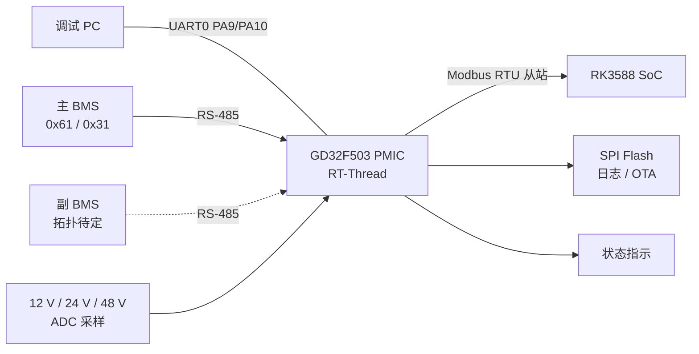

# RP1.4 背板电源管理芯片（PMIC）

> 基于 GD32F503 与 RT-Thread 5.3.0 的 RP1.4 背板电源管理固件。

| 状态 | MCU | RTOS | 对外接口 |
| --- | --- | --- | --- |
| 开发中（骨架） | GD32F503 / Cortex-M33 | RT-Thread 5.3.0 | BMS RS-485 + SoC Modbus |

PMIC 负责采集背板 12 V / 24 V / 48 V 输出电压，管理主副 BMS 通信，向 RK3588 SoC 提供 Modbus 数据，并将运行与故障日志保存到 SPI Flash。

> 当前仓库仍处于骨架阶段：调试串口与板级启动可用，BMS 协议类已实现但未接入 `main()`，Modbus、ADC、SPI Flash、故障策略与 OTA 尚未实现。详见[当前状态](#当前状态)。

## 当前状态

| 模块 | 状态 | 说明 |
| --- | --- | --- |
| 板级启动 / SysTick / 控制台 | 可用 | `boards/roboparty_pmic/board.c`，控制台为 `uart0` |
| BMS `0x31` 查询与 CRC 校验 | 已实现，未接入 | `src/scud_bms_rtt.cpp`，尚未在 `main()` 中实例化 |
| BMS `0x61` 查询 | 未实现 | 协议已约定，代码未实现 |
| 副 BMS 管理 | 未实现 | 型号与总线拓扑待确认 |
| SoC Modbus 从站 | 未实现 | 仅约定数据区布局 |
| 12 V / 24 V / 48 V ADC | 未启用 | Kconfig 默认关闭，分压参数待定 |
| SPI Flash 日志 / OTA | 未启用 | 分区与磨损均衡策略待定 |
| 故障三帧确认策略 | 设计完成，未实现 | 见[故障策略](#故障策略) |
| 可烧录固件 | 未完成 | 当前 CMake 仅生成 `libroboparty_pmic.a` |

## 系统架构



## 硬件平台

| 项目 | 定义 | 依据 |
| --- | --- | --- |
| MCU | GD32F503，Cortex-M33 | `CMakeLists.txt` |
| Flash / SRAM | 512 KB / 128 KB | `boards/roboparty_pmic/linker_scripts/link.ld` |
| 封装 | 待确认 | 需核对实际物料 |
| RTOS | RT-Thread 5.3.0 | `inc/rtconfig.h`（`RT_VER_NUM 0x50300`） |
| 调试串口 | USART0，115200 8N1 | `BSP_UART0_*` |
| 主 BMS | 飞毛腿（SCUD）21700 电池包，UART 转 RS-485 | 项目设计 |
| 副 BMS | 待选型 | 项目设计 |
| SoC | RK3588，UART + Modbus RTU | 项目设计 |
| 输出采集 | 12 V、24 V、48 V 三路 ADC | 项目设计 |
| 外部存储 | SPI Flash | 项目设计 |

## 引脚分配

固件中真正落地的引脚只有调试串口。`boards/roboparty_pmic/Kconfig` 中 UART1～UART3 的 `PA8/PA9` 是模板默认值，**不代表本板实际连接**；下表“待分配”项必须以原理图/线束图为准，确认后再写入 `rtconfig.h`。

### 已配置

| 用途 | 信号 | 外设 | 引脚 | 复用 | 固件配置 |
| --- | --- | --- | --- | --- | --- |
| 调试控制台 | UART0_TX | USART0 | PA9 | AF1 | `BSP_UART0_TX_PIN` |
| 调试控制台 | UART0_RX | USART0 | PA10 | AF1 | `BSP_UART0_RX_PIN` |

串口参数为 115200 baud、8N1，控制台设备名为 `uart0`。

### 调试接口

| 用途 | 信号 | 引脚 | 说明 |
| --- | --- | --- | --- |
| SWD 调试 | SWDIO | PA13 | 芯片默认调试口，最终以数据手册为准 |
| SWD 调试 | SWCLK | PA14 | 同上 |

### 待分配

| 用途 | 信号 | 建议外设 | 引脚 | 说明 |
| --- | --- | --- | --- | --- |
| 主 BMS 通信 | BMS_TX / BMS_RX | USART1 | TBD | 外接 RS-485 收发器，115200 8N1 |
| RS-485 方向控制 | RS485_DE / RE | GPIO | TBD | 发送时拉高，接收时拉低 |
| 副 BMS 通信 | TBD | TBD | TBD | 与主 BMS 共用总线或独立 UART，待确认 |
| RK3588 SoC 通信 | SOC_TX / SOC_RX | USART2 | TBD | Modbus RTU 从站 |
| SPI Flash | SCK / MOSI / MISO / CS | SPI1 | TBD | 日志、OTA 镜像 |
| 12 V 输出采样 | ADC_12V | ADC0 | TBD | 分压后必须限制在 0～3.3 V |
| 24 V 输出采样 | ADC_24V | ADC0 | TBD | 同上 |
| 48 V 输出采样 | ADC_48V | ADC0 | TBD | 同上，按最高电压留裕量 |
| 充电通路控制 | CHG_EN | GPIO | TBD | 故障策略要求，具体信号名以原理图为准 |
| 状态指示 | LED_RUN / LED_FAULT | GPIO | TBD | 数量与颜色待定 |

板上连接器位号、线序和线束定义尚未在本仓库中记录，需由原理图与线束图补充。

## 通信协议

### 主 BMS：RS-485

串口参数为 115200 baud、8N1、高字节优先。

```text
FE FE | CMD | LEN | DATA[LEN] | CRC16_H | CRC16_L | BB
```

CRC 覆盖 `CMD + LEN + DATA`，使用 CRC16-CCITT（等价于 CRC-16/XMODEM），初值 `0`，多项式 `0x1021`。校验向量：`"123456789"` → `0x31C3`。

| 命令 | 含义 | 状态 |
| --- | --- | --- |
| `0x61` | BMS 通用信息查询 | 未实现 |
| `0x31` | 电池信息汇总查询 | 已实现，默认 1 s 轮询 |

`0x31` 响应前 11 字节的解析如下，帧内其余字节暂未使用：

| 偏移 | 字段 | 类型 | 单位 |
| ---: | --- | --- | --- |
| 0–1 | 电压 | `u16` | mV |
| 2–3 | 电流 | `i16` | mA |
| 4–5 | 温度 | `i16` | 0.1 °C |
| 6 | SOC | `u8` | % |
| 7–10 | 保护状态 | `u32` | 位域 |

### SoC：Modbus

MCU 作为 Modbus RTU 从站，地址为 `0x01`，响应 RK3588 的读取请求。

| 数据区 | 起始地址 | 长度 |
| --- | ---: | ---: |
| 主 BMS 通用信息 | `0x00` | 30 字节 |
| 主 BMS 信息汇总 | `0x1E` | 39 字节 |
| 输出电压 | `0x45` | 12 字节 |
| LED 信息 | 待定 | 待定 |

> 上述地址按字节偏移定义。标准 Modbus 以 16 位寄存器寻址，寄存器宽度、字节序、功能码（`0x03`/`0x04`）和异常响应仍需确认并实现。

## 故障策略

通信故障采用三帧确认：连续三帧 CRC 错误或超时确认故障，连续三帧正常确认恢复。

| 故障 | 故障行为 | 恢复行为 |
| --- | --- | --- |
| SoC 通信 | 写入 `flash_log`，暂停向 SoC 发送数据 | 记录恢复并恢复通信 |
| 主 BMS 通信 | 保持最后有效数据，禁止相关充电路径 | 恢复数据更新并允许充电 |
| 主 BMS 状态 | 记录故障，按策略禁止充电 | 故障清除后记录恢复 |
| 副 BMS 通信 | 保持最后有效数据，禁止相关充电路径 | 连续三帧正常后恢复 |
| Flash 存储 | 向 SoC 报告存储失败 | 连续三次成功后报告恢复 |
| 输出电压 | 写入 `exception_log` | 回到恢复阈值后记录恢复 |

该表为设计目标，尚未在代码中实现。

## 日志与 OTA

SPI Flash 计划保存 `routine_log`、`exception_log`、`MCU_OTA_BIN` 以及主副 BMS 升级镜像。运行日志周期写入，故障事件立即写入。日志字段包括 `ts`、`type`、`level`、`module`、`event`、`msg` 和 `detail`。

系统需要支持量产烧录、MCU OTA、主 BMS OTA、副 BMS OTA、完整性校验和失败回滚。当前尚未实现分区表、磨损均衡、签名校验和回滚机制。

## 工程结构

```text
boards/roboparty_pmic/       板级启动、时钟、Kconfig 和链接脚本
src/                         PMIC 应用入口与 BMS 适配
inc/                         rtconfig.h 与项目头文件
thirdparty/
  GD32F50x_Firmware_Library_V1.0.3/  GD32F503 厂商 SDK（已解压）
  GD32F50x_Firmware_Library_V1.0.3.7z  原始 SDK 压缩包
  roboparty_bms/             BMS 协议参考实现（git submodule）
CMakeLists.txt               编译验证入口
env.ps1                      RT-Thread 和 SDK 环境变量
PROJECT_LAYOUT.md            目录迁移说明
```

子模块初始化：

```powershell
git submodule update --init --recursive
```

## 构建

依赖：`arm-none-eabi-gcc`、CMake、Ninja，以及 `D:\env\rt-thread-5.3.0\rt-thread-5.3.0` 下的 RT-Thread 5.3.0 源码。

```powershell
. .\env.ps1
cmake -S . -B build-scud -G Ninja `
  -DCMAKE_C_COMPILER=arm-none-eabi-gcc `
  -DCMAKE_CXX_COMPILER=arm-none-eabi-g++ `
  -DCMAKE_ASM_COMPILER=arm-none-eabi-gcc
cmake --build build-scud
```

当前构建只做编译验证，产物为 `libroboparty_pmic.a`，不生成 `.elf` / `.bin` / `.hex`。生成可烧录固件前，还需接入启动文件、向量表、完整链接布局和 RT-Thread 驱动。

## 待确认项

硬件：

- GD32F503 具体封装、Flash/RAM 容量与量产物料型号。
- `boards/roboparty_pmic/Kconfig` 仍沿用 GD32E503VE 模板，需改为 GD32F503 实际系列/型号。
- 主副 BMS 型号、总线拓扑和 OTA 协议。
- 12 V、24 V、48 V 的 ADC 引脚、分压参数和采样周期。
- 输出电压过压、欠压和恢复阈值。
- 充电通路控制信号及板上连接器/线束定义。
- SPI Flash 型号、分区和磨损均衡策略。
- LED 数量、颜色与驱动方式。

软件：

- BMS `0x61` 查询与副 BMS 管理。
- Modbus 功能码、寄存器映射、时间戳同步和 LED 数据格式。
- 故障三帧确认状态机与充电禁止逻辑。
- 日志持久化、OTA 签名校验和失败回滚。
- 量产烧录流程。
- 完整固件链接与硬件在环验证。

## 相关文档

- [目录迁移说明](PROJECT_LAYOUT.md)
- [BMS 参考实现说明](thirdparty/roboparty_bms/README_CN.md)
