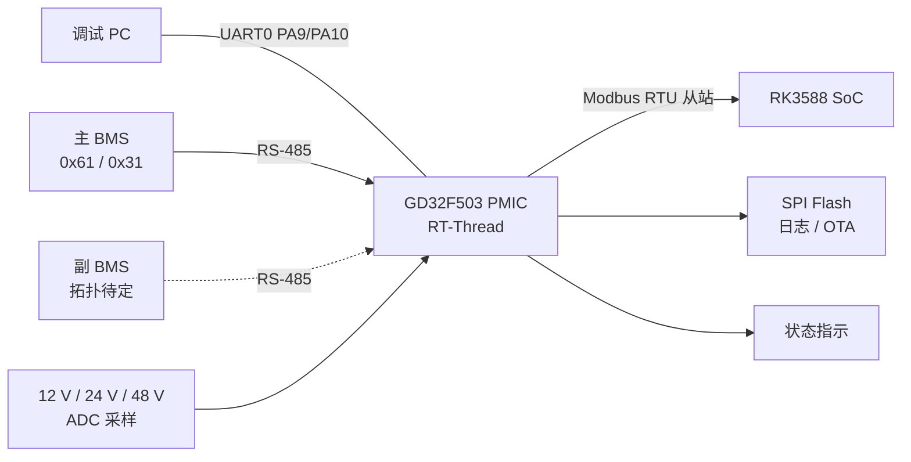

# RP1.4 背板电源管理芯片（PMIC）

> GD32F503VET6 参考充电固件使用 RT-Thread 5.3.0；引脚由软件先定义，尚无对应实板确认。

| 状态 | MCU | RTOS | 对外接口 |
| --- | --- | --- | --- |
| 可交叉编译，未做 GD32 实板验证 | GD32F503VET6 / Cortex-M33 | RT-Thread 5.3.0 | 115200 UART 命令、内部 Flash OTA |

原规划是采集背板 12 V / 24 V / 48 V 输出电压、管理主副 BMS、提供 Modbus 数据及 SPI Flash 日志。当前 GD32 参考镜像实现的是 USB-PD 充电控制和文本串口协议，不包含这些原规划模块。

> 本次新增的 `boards/gd32f503_pmic/CMakeLists.txt` 可链接 bootloader 和充电应用。下文原有 BMS/Modbus/SPI Flash 架构仍是另一套设计目标，不能据此认为这些功能已进入 GD32 充电镜像。默认构建会强制保持充电 EN 关闭；仅当实板引脚、ADC 分压和带载保护验证完成后，才可用 `-DPMIC_GD32_HARDWARE_VERIFIED=ON` 重新构建。GitHub Release 另需仓库变量 `GD32_HARDWARE_VERIFIED=true`，避免发布未验证镜像。

## 当前状态

| 模块 | 状态 | 说明 |
| --- | --- | --- |
| 板级启动 / SysTick / 控制台 | 编译通过，未实测 | `boards/gd32f503_pmic/board.c`，USART0 注册为 `uart3` |
| 充电 ADC / PWM / GPIO / UART 协议 | 编译通过，未实测 | 复用 STM32 左板应用，GD32 驱动位于 `boards/gd32f503_pmic/drivers/` |
| 内部 Flash OTA | 编译通过，未实测 | boot/app/staging/config 分区位于 512 KB Flash 内 |
| 芯片 UID / 固件版本 | 编译通过，未实测 | `SN_GET:1;` 读取 96 位 UID，版本为 `0.1.0-gd32` |
| BMS `0x31` 查询与 CRC 校验 | 已实现，未接入 | `src/scud_bms_rtt.cpp`，尚未在 `main()` 中实例化 |
| BMS `0x61` 查询 | 未实现 | 协议已约定，代码未实现 |
| 副 BMS 管理 | 未实现 | 型号与总线拓扑待确认 |
| SoC Modbus 从站 | 未实现 | 仅约定数据区布局 |
| 12 V / 24 V / 48 V ADC | 未启用 | Kconfig 默认关闭，分压参数待定 |
| SPI Flash 日志 / OTA | 未启用 | 分区与磨损均衡策略待定 |
| 故障三帧确认策略 | 设计完成，未实现 | 见[故障策略](#故障策略) |
| 可链接固件 | 已生成，未烧录 | GD32 bootloader 与 `ChargeBAT_GD32.bin`；旧的顶层 CMake 静态库仍保留 |

## 原规划系统架构



## 硬件平台

| 项目 | 定义 | 依据 |
| --- | --- | --- |
| MCU | GD32F503，Cortex-M33 | `CMakeLists.txt` |
| Flash / SRAM | 512 KB / 64 KB | [GD32F503VET6 数据手册](https://www.gd32mcu.com/data/documents/datasheet/GD32F503xx_Datasheet_Rev0.9RC6.pdf)与链接脚本 |
| 封装 | LQFP100（参考目标） | 同上 |
| RTOS | RT-Thread 5.3.0 | `inc/rtconfig.h`（`RT_VER_NUM 0x50300`） |
| 主机串口 | USART0，115200 8N1 | PA9/PA10，注册为 `uart3` |
| 主 BMS | 飞毛腿（SCUD）21700 电池包，UART 转 RS-485 | 项目设计 |
| 副 BMS | 待选型 | 项目设计 |
| SoC | RK3588，UART + Modbus RTU | 项目设计 |
| 输出采集 | 12 V、24 V、48 V 三路 ADC | 项目设计 |
| 外部存储 | SPI Flash | 项目设计 |

## 引脚分配

以下是新充电应用的软件引脚约定，尚无 GD32 原理图。`Kconfig` 中旧的 GD32E503 模板配置不是该 CMake 工程的依据。

### 已配置

| 用途 | 信号 | 外设 | 引脚 | 复用 | 固件配置 |
| --- | --- | --- | --- | --- | --- |
| 主机串口 TX | UART_TX | USART0 | PA9 | AF0 | `uart3` |
| 主机串口 RX | UART_RX | USART0 | PA10 | AF0 | `uart3` |
| 充电电流采样 | CHRG_I | ADC0 | PA0 | 模拟 | `bsp_adc_values[0]` |
| 电池电压采样 | BAT_V | ADC0 | PA1 | 模拟 | `bsp_adc_values[1]` |
| 充电输入采样 | CHRG_V | ADC0 | PA2 | 模拟 | `bsp_adc_values[2]` |
| 充电电流控制 | ICTRL | TIMER16_CH1 | PA3 | AF2 | PWM，上电 0 |
| 充电红/绿灯 | LED_R / LED_G | GPIO | PA4 / PA5 | GPIO | 高电平亮 |
| 电池绿/红灯 | BAT_G / BAT_R | GPIO | PA6 / PA7 | GPIO | 高电平亮 |
| 风扇 | FAN | TIMER0_CH0 | PA8 | AF1 | PWM |
| 充电使能 | CHG_EN | GPIO | PB3 | GPIO | 高电平使能，上电低 |
| PD 与温度 I2C | SCL / SDA | GPIO | PB8 / PB9 | 开漏 | CH224 / TMP100 软件 I2C |

串口参数为 115200 baud、8N1。该软件约定要求外部 8 MHz HXTAL、与 STM32 左板相同的 ADC 分压比及外部电源电路；这些硬件条件尚未核对。

### 调试接口

| 用途 | 信号 | 引脚 | 说明 |
| --- | --- | --- | --- |
| SWD 调试 | SWDIO | PA13 | 芯片默认调试口，最终以数据手册为准 |
| SWD 调试 | SWCLK | PA14 | 同上 |

### 原规划待分配（不属于参考充电镜像）

| 用途 | 信号 | 建议外设 | 引脚 | 说明 |
| --- | --- | --- | --- | --- |
| 主 BMS 通信 | BMS_TX / BMS_RX | USART1 | TBD | 外接 RS-485 收发器，115200 8N1 |
| RS-485 方向控制 | RS485_DE / RE | GPIO | TBD | 发送时拉高，接收时拉低 |
| 副 BMS 通信 | TBD | TBD | TBD | 与主 BMS 共用总线或独立 UART，待确认 |
| RK3588 SoC 通信 | SOC_TX / SOC_RX | USART2 | TBD | Modbus RTU 从站 |
| SPI Flash | SCK / MOSI / MISO / CS | SPI1 | TBD | 日志、OTA 镜像 |
| 12 V 输出采样 | ADC_12V | ADC0 | TBD | 分压后必须限制在 0～3.3 V |
| 24 V 输出采样 | ADC_24V | ADC0 | TBD | 同上 |
| 48 V 输出采样 | ADC_48V | ADC0 | TBD | 同上，按最高电压留裕量 |
| 充电通路控制 | CHG_EN | GPIO | TBD | 故障策略要求，具体信号名以原理图为准 |
| 状态指示 | LED_RUN / LED_FAULT | GPIO | TBD | 数量与颜色待定 |

板上连接器位号、线序和线束定义尚未在本仓库中记录，需由原理图与线束图补充。

## 通信协议

### 主 BMS：RS-485

串口参数为 115200 baud、8N1、高字节优先。

```text
FE FE | CMD | LEN | DATA[LEN] | CRC16_H | CRC16_L | BB
```

CRC 覆盖 `CMD + LEN + DATA`，使用 CRC16-CCITT（等价于 CRC-16/XMODEM），初值 `0`，多项式 `0x1021`。校验向量：`"123456789"` → `0x31C3`。

| 命令 | 含义 | 状态 |
| --- | --- | --- |
| `0x61` | BMS 通用信息查询 | 未实现 |
| `0x31` | 电池信息汇总查询 | 已实现，默认 1 s 轮询 |

`0x31` 响应前 11 字节的解析如下，帧内其余字节暂未使用：

| 偏移 | 字段 | 类型 | 单位 |
| ---: | --- | --- | --- |
| 0–1 | 电压 | `u16` | mV |
| 2–3 | 电流 | `i16` | mA |
| 4–5 | 温度 | `i16` | 0.1 °C |
| 6 | SOC | `u8` | % |
| 7–10 | 保护状态 | `u32` | 位域 |

### SoC：Modbus

MCU 作为 Modbus RTU 从站，地址为 `0x01`，响应 RK3588 的读取请求。

| 数据区 | 起始地址 | 长度 |
| --- | ---: | ---: |
| 主 BMS 通用信息 | `0x00` | 30 字节 |
| 主 BMS 信息汇总 | `0x1E` | 39 字节 |
| 输出电压 | `0x45` | 12 字节 |
| LED 信息 | 待定 | 待定 |

> 上述地址按字节偏移定义。标准 Modbus 以 16 位寄存器寻址，寄存器宽度、字节序、功能码（`0x03`/`0x04`）和异常响应仍需确认并实现。

## 故障策略

通信故障采用三帧确认：连续三帧 CRC 错误或超时确认故障，连续三帧正常确认恢复。

| 故障 | 故障行为 | 恢复行为 |
| --- | --- | --- |
| SoC 通信 | 写入 `flash_log`，暂停向 SoC 发送数据 | 记录恢复并恢复通信 |
| 主 BMS 通信 | 保持最后有效数据，禁止相关充电路径 | 恢复数据更新并允许充电 |
| 主 BMS 状态 | 记录故障，按策略禁止充电 | 故障清除后记录恢复 |
| 副 BMS 通信 | 保持最后有效数据，禁止相关充电路径 | 连续三帧正常后恢复 |
| Flash 存储 | 向 SoC 报告存储失败 | 连续三次成功后报告恢复 |
| 输出电压 | 写入 `exception_log` | 回到恢复阈值后记录恢复 |

该表为设计目标，尚未在代码中实现。

## 日志与 OTA

SPI Flash 计划保存 `routine_log`、`exception_log`、`MCU_OTA_BIN` 以及主副 BMS 升级镜像。运行日志周期写入，故障事件立即写入。日志字段包括 `ts`、`type`、`level`、`module`、`event`、`msg` 和 `detail`。

参考充电镜像使用 GD32 内部 Flash 的 boot/app/staging/config 分区实现 MCU OTA；主副 BMS OTA、SPI Flash 日志、签名校验和失败回滚仍未实现。

## 工程结构

```text
boards/gd32f503_pmic/       GD32 充电应用、驱动、bootloader、链接脚本
src/                         旧静态库入口与 BMS 适配（不进入充电镜像）
inc/                         旧静态库配置
thirdparty/
  GD32F50x_Firmware_Library_V1.0.3/  GD32F503 厂商 SDK（已解压）
  GD32F50x_Firmware_Library_V1.0.3.7z  原始 SDK 压缩包
  roboparty_bms/             BMS 协议参考实现（git submodule）
CMakeLists.txt               旧静态库编译入口
env.ps1                      RT-Thread 和 SDK 环境变量
PROJECT_LAYOUT.md            目录迁移说明
```

子模块初始化：

```powershell
git submodule update --init --recursive
```

## 构建

依赖：`arm-none-eabi-gcc`、CMake、Ninja、RT-Thread 5.3.0 源码及仓库的 GD32 SDK 压缩包。Windows 可用 `D:\env\rt-thread-5.3.0\rt-thread-5.3.0` 设置 `RTT_ROOT`；CI 自动准备依赖。

```powershell
$env:RTT_ROOT = 'D:\env\rt-thread-5.3.0\rt-thread-5.3.0'
cmake -S boards/gd32f503_pmic/bootloader -B build-gd32-boot -G Ninja
cmake --build build-gd32-boot
cmake -S boards/gd32f503_pmic -B build-gd32-app -G Ninja `
  -DCMAKE_TOOLCHAIN_FILE=boards/gd32f503_pmic/cmake/gcc-arm-none-eabi.cmake
cmake --build build-gd32-app
```

产物为 `boot.bin/hex` 与 `ChargeBAT_GD32.bin/hex`。CI 同时打包 STM32F103C8 和 GD32F503 两份固件；GD32 默认镜像仅供软件验证，充电 EN 被强制关闭。没有实板验证时 Release 门禁保持关闭。

## 待确认项

硬件：

- 实板芯片是否采用参考目标 GD32F503VET6，晶振和电源是否匹配。
- `boards/gd32f503_pmic/Kconfig` 仍沿用 GD32E503VE 模板，需改为 GD32F503 实际系列/型号。
- 主副 BMS 型号、总线拓扑和 OTA 协议。
- 12 V、24 V、48 V 的 ADC 引脚、分压参数和采样周期。
- 输出电压过压、欠压和恢复阈值。
- 充电通路控制信号及板上连接器/线束定义。
- SPI Flash 型号、分区和磨损均衡策略。
- LED 数量、颜色与驱动方式。

软件：

- BMS `0x61` 查询与副 BMS 管理。
- Modbus 功能码、寄存器映射、时间戳同步和 LED 数据格式。
- 故障三帧确认状态机与充电禁止逻辑。
- 日志持久化、OTA 签名校验和失败回滚。
- 量产烧录流程。
- 完整固件链接与硬件在环验证。

## 相关文档

- [目录迁移说明](PROJECT_LAYOUT.md)
- [BMS 参考实现说明](thirdparty/roboparty_bms/README_CN.md)
